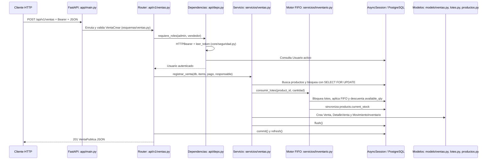

# Arquitectura del backend EIP

## 1. Resumen en 5 líneas

1. Es una API REST para gestionar usuarios, productos, inventario, ventas, mermas, movimientos, comercio exterior y un dashboard.
2. Está implementada como un monolito modular: una sola aplicación FastAPI agrupa routers por dominio bajo `/api/v1`.
3. Los routers reciben y validan HTTP; los servicios contienen las reglas de negocio; los modelos SQLAlchemy representan la persistencia y los esquemas Pydantic definen el contrato JSON.
4. La base de datos está preparada para PostgreSQL mediante SQLAlchemy asíncrono y `asyncpg`, con migraciones Alembic; los tests usan SQLite asíncrono en memoria.
5. La seguridad combina JWT Bearer, bcrypt, consulta de usuario activo, autorización por roles, secretos en variables de entorno y CORS configurable.

## 2. Tipo de arquitectura

### Arquitectura en capas

Se observa una separación práctica entre:

- `app/api/`: transporte HTTP, routers y dependencias de FastAPI.
- `app/esquemas/`: modelos Pydantic de entrada y salida, incluidos aliases camelCase en `app/esquemas/comun.py`.
- `app/servicios/`: reglas de negocio y operaciones transaccionales, por ejemplo `app/servicios/ventas.py` y `app/servicios/inventario.py`.
- `app/modelo/`: entidades SQLAlchemy y relaciones con las tablas.
- `app/bd/`: engine, sesiones y metadata común.

Esto reduce el acoplamiento entre el contrato HTTP, la lógica del negocio y la persistencia. La separación no es absoluta: algunos routers construyen directamente DTOs de respuesta, por ejemplo `_venta_publica()` en `app/api/v1/ventas.py`, y los routers ejecutan explícitamente `commit()`.

### API REST

`app/main.py` registra routers HTTP bajo `/api/v1`; los módulos de `app/api/v1/` exponen recursos como `/productos`, `/ventas`, `/lotes`, `/mermas`, `/movimientos` y `/comercio-exterior/operaciones`. Las respuestas son JSON directo, sin envoltorio `data`, y usan códigos HTTP como `201`, `401`, `403`, `404`, `409` y `422`.

Resuelve la integración con clientes web y mantiene un contrato explícito y autodocumentado mediante `/docs`, `/redoc` y `/openapi.json`. No se trata de microservicios: todos los dominios viven y se despliegan dentro del mismo proceso.

### Monolito modular

`app/main.py` crea una única instancia `FastAPI` e incluye los routers de autenticación, catálogos, productos, usuarios, lotes, inventario, movimientos, ventas, comercio exterior y dashboard. Los módulos tienen fronteras por dominio, pero comparten proceso, configuración, sesión y base de datos.

Esto simplifica las transacciones que atraviesan varias entidades, por ejemplo una venta que actualiza lotes, producto, venta, detalle y ledger. El coste es que un cambio o despliegue afecta a toda la aplicación y los módulos no tienen aislamiento operativo independiente.

### Inyección de dependencias de FastAPI

`app/api/deps.py` define `get_db()`, `usuario_actual()` y la fábrica `requiere_roles(*roles)`. Los routers las consumen con `Depends`, por ejemplo `app/api/v1/ventas.py` inyecta la sesión y el usuario autorizado.

La dependencia resuelve por request la sesión, el token Bearer, el usuario activo y el rol. Facilita composición, pruebas y sustitución: los tests reemplazan `get_db` con `app.dependency_overrides`.

### Sesión por request y Unit of Work práctico

`app/bd/session.py` crea `AsyncSessionLocal` y entrega una `AsyncSession` por request mediante `get_db()`. Si el bloque falla, hace `rollback()` y relanza la excepción. Los routers de escritura, como `app/api/v1/ventas.py` y `app/api/v1/inventario.py`, llaman al servicio y hacen `await db.commit()` cuando la operación completa terminó.

Esto funciona como un Unit of Work práctico: varias escrituras comparten la misma sesión y se confirman juntas. No existe una clase formal llamada `UnitOfWork`, y la responsabilidad del `commit` está repartida entre routers; esa decisión es simple, pero exige que cada router de escritura respete el mismo patrón.

### ORM y migraciones

`app/modelo/` usa el estilo SQLAlchemy 2 (`Mapped`, `mapped_column`, `DeclarativeBase`). `app/bd/base.py` importa todos los modelos para que Alembic conozca el grafo completo. `alembic/env.py` carga `.env`, configura metadata y soporta migraciones async para PostgreSQL y una ruta local para SQLite.

La revisión `alembic/versions/20260928_0001_fase_1_base_datos.py` crea tablas, claves foráneas, índices y restricciones sin downgrade destructivo. La migración detecta la tabla `users` existente para no recrearla.

## 3. Diagrama de capas: `POST /api/v1/ventas`

El rollback ante una excepción ocurre en `get_db()`. Por eso, si falta stock o falla una validación posterior, no queda persistida una venta parcial dentro de esa sesión.

## 4. Tecnologías

Las versiones no fijadas en los manifests se indican como `no fijada`; no se debe presentar una versión exacta sin evidencia del archivo de dependencias.

| Tecnología | Versión | Para qué se usa aquí | Dónde se ve |
|---|---|---|---|
| FastAPI | no fijada | Framework HTTP, routing, dependencias, OpenAPI y handlers | `requirements.txt`, `app/main.py` |
| Uvicorn | no fijada | Servidor ASGI para ejecutar FastAPI | `requirements.txt`, README de ejecución |
| SQLAlchemy 2 async | no fijada; se usa API 2.x | ORM, consultas, relaciones, transacciones y engine async | `requirements.txt`, `app/bd/session.py`, `app/modelo/` |
| asyncpg | no fijada | Driver async de PostgreSQL | `requirements.txt`, `DATABASE_URL` esperada por `app/core/config.py` |
| PostgreSQL / Supabase | servidor externo, versión no fijada | Base de datos objetivo de producción | `app/core/config.py`, `alembic/env.py`, `docs/DEPLOYMENT_CHECKLIST.md` |
| Alembic | no fijada | Migraciones y evolución del esquema | `requirements.txt`, `alembic/env.py`, `alembic/versions/` |
| Pydantic v2 | no fijada; `ConfigDict` confirma API v2 | Validación de requests/responses y serialización | `requirements.txt`, `app/esquemas/` |
| pydantic-settings | no fijada | Lectura tipada de `.env` y variables de entorno | `requirements.txt`, `app/core/config.py` |
| python-jose | no fijada | Firma y validación de JWT con algoritmo configurable | `requirements.txt`, `app/core/seguridad.py` |
| passlib | no fijada | Contexto de hashing y verificación de contraseñas | `requirements.txt`, `app/core/seguridad.py` |
| bcrypt | `3.2.2` | Algoritmo usado por Passlib para contraseñas | `requirements.txt`, `CryptContext` en `app/core/seguridad.py` |
| pytest | no fijada | Tests unitarios y de integración | `requirements-dev.txt`, `tests/` |
| pytest-asyncio | no fijada | Fixtures y ejecución de tests async | `requirements-dev.txt`, `tests/*.py` |
| httpx | no fijada | Cliente HTTP async contra ASGI en pruebas | `requirements-dev.txt`, `tests/*.py` |
| aiosqlite | no fijada | SQLite async en memoria para tests locales | `requirements-dev.txt`, fixtures de `tests/` |
| email-validator | no fijada | Validación de campos de email de Pydantic | `requirements.txt`, esquemas de usuarios/login |
| Python `Decimal` | biblioteca estándar | Cantidades y dinero con redondeo decimal exacto | `app/servicios/inventario.py`, modelos y esquemas |
| Mermaid | no es dependencia runtime | Notación de este documento, no componente de la aplicación | `docs/ARQUITECTURA.md` |

La guía `docs/GUIA_BACKEND.md` habla de PostgreSQL/Supabase como destino y de dependencias directas; el código confirma el driver async y las URLs configurables, pero `requirements.txt` no fija versiones de FastAPI, SQLAlchemy, Alembic ni del resto salvo bcrypt.

## 5. Responsabilidad de carpetas y archivos clave

### Carpetas

| Ruta | Responsabilidad |
|---|---|
| `app/` | Paquete principal de la API. |
| `app/api/` | Capa HTTP: dependencias y routers. |
| `app/api/v1/` | Endpoints versionados por módulo funcional. |
| `app/bd/` | Engine, sesiones, metadata e inicialización de datos. |
| `app/core/` | Configuración, seguridad y errores transversales. |
| `app/esquemas/` | Contratos Pydantic de entrada y salida. |
| `app/modelo/` | Entidades SQLAlchemy y tablas persistidas. |
| `app/servicios/` | Reglas de negocio y operaciones sobre varias entidades. |
| `alembic/` | Configuración y revisiones de migración. |
| `tests/` | Tests unitarios, de integración HTTP y de consistencia. |

### Archivos importantes

| Archivo | Responsabilidad |
|---|---|
| `app/main.py` | Crea FastAPI, registra handlers, logging HTTP, CORS y routers bajo `/api/v1`. |
| `app/core/config.py` | Lee `DATABASE_URL`, `SECRET_KEY`, algoritmo, expiración y `CORS_ORIGINS` desde `.env`. |
| `app/core/seguridad.py` | Hashea/verifica contraseñas con bcrypt y crea/lee JWT con `exp`. |
| `app/core/errores.py` | Define `ErrorDeNegocio` y normaliza errores HTTP, de validación y no controlados. |
| `app/api/deps.py` | Provee la sesión, valida el usuario actual y aplica roles. |
| `app/bd/session.py` | Crea el engine async y la sesión por request; hace rollback ante excepción. |
| `app/bd/base.py` | Define `Base` e importa los modelos para la metadata de Alembic. |
| `app/bd/seed.py` | Contiene el seed idempotente de catálogos. |
| `app/esquemas/comun.py` | Define `CamelModel`, aliases snake_case/camelCase y `from_attributes`. |
| `app/esquemas/login.py` | Request del login. |
| `app/esquemas/ventas.py` | Validación y contratos de creación/respuesta de ventas. |
| `app/esquemas/entradas.py`, `mermas.py`, `lotes.py` | Contratos de inventario, entradas, mermas y lotes. |
| `app/esquemas/productos.py`, `usuarios.py`, `catalogos.py` | Contratos de productos, usuarios y catálogos. |
| `app/esquemas/movimientos.py`, `comercio_exterior.py`, `dashboard.py` | Contratos del ledger, comercio exterior y KPIs. |
| `app/api/v1/auth.py` | `POST /auth/login` y `GET /auth/me`. |
| `app/api/v1/usuarios.py` | CRUD de usuarios protegido para admin. |
| `app/api/v1/productos.py` | CRUD de productos y sus permisos. |
| `app/api/v1/catalogos.py` | Lectura de categorías, proveedores y socios comerciales. |
| `app/api/v1/lotes.py` | Consulta de lotes y orden FIFO. |
| `app/api/v1/inventario.py` | Entradas, compras y mermas. |
| `app/api/v1/ventas.py` | Registro y consulta de ventas; convierte entidades a `VentaPublica`. |
| `app/api/v1/movimientos.py` | Consulta administrativa del ledger. |
| `app/api/v1/comercio_exterior.py` | Importaciones y exportaciones. |
| `app/api/v1/dashboard.py` | Resumen y alertas para administradores. |
| `app/api/v1/analisis.py`, `app/api/v1/tokens.py` | Existen, pero están vacíos y no se incluyen en `app/main.py`; no son capacidades actuales. |
| `app/servicios/inventario.py` | Núcleo FIFO, locks de lotes, redondeo, stock derivado y consistencia. |
| `app/servicios/operaciones_inventario.py` | Orquesta entradas de producción, compras y mermas. |
| `app/servicios/ventas.py` | Recalcula una venta, consume stock y escribe detalles y ledger. |
| `app/servicios/comercio_exterior.py` | Calcula operaciones, genera folios y mueve stock en importación/exportación. |
| `app/servicios/dashboard.py` | Calcula KPIs, serie semanal, top de productos y alertas. |
| `app/servicios/productos.py`, `movimientos.py`, `apertura.py` | Reglas de productos, consultas del ledger y apertura idempotente de lotes. |
| `app/modelo/usuarios.py` | Tabla `users` y roles `ADMIN`, `VENDEDOR`, `TALLER`. |
| `app/modelo/productos.py`, `categorias.py`, `proveedores.py` | Tablas de productos y catálogos. |
| `app/modelo/lotes.py`, `entradas.py`, `mermas.py` | Lotes, entradas de stock y desperdicios. |
| `app/modelo/movimientos.py` | Ledger de movimientos de inventario. |
| `app/modelo/ventas.py` | Ventas y snapshots de sus líneas. |
| `app/modelo/comercio_exterior.py`, `socios_comerciales.py`, `contadores.py` | Operaciones, socios y contadores de folios. |
| `alembic/env.py` | Configura Alembic con `.env`, metadata y conexión async/sync según el motor. |
| `alembic/versions/20260928_0001_fase_1_base_datos.py` | Crea el esquema base, índices, FKs y tablas de contadores. |

## 6. Seguridad

### Autenticación

1. `POST /api/v1/auth/login` recibe email y contraseña mediante `LoginRequest` en `app/esquemas/login.py`.
2. `app/api/v1/user.py` busca al usuario y verifica la contraseña con `pwd_context` de `app/core/seguridad.py`.
3. La contraseña se almacena como hash bcrypt; nunca se devuelve `hashed_password`.
4. Si las credenciales no coinciden, el login devuelve el mismo `401` y el mensaje `Email o contraseña incorrectos`, sin revelar si el email existe.
5. Si la cuenta está inactiva, devuelve `403` con el mensaje definido en el router.
6. `crear_token()` firma un JWT con `SECRET_KEY`, algoritmo `HS256` por defecto, `id`, `role` y `exp`.
7. La expiración es configurable mediante `ACCESS_TOKEN_EXPIRE_MINUTES`, cuyo valor por defecto real es `480` minutos.
8. `usuario_actual()` usa `HTTPBearer`, valida el JWT con `leer_token()` y vuelve a consultar `users`; por tanto, desactivar al usuario invalida el acceso aunque el JWT no haya expirado.

### Autorización por rol

`requiere_roles(*roles)` normaliza los roles a mayúsculas y devuelve `403` si el usuario autenticado no pertenece al conjunto permitido. Ejemplos: ventas permite `admin` y `vendedor`; movimientos y dashboard permiten solo `admin`; entradas de producción y mermas permiten `taller`.

El rol se toma del usuario de la base de datos para autorizar; el token lleva también el rol, pero `usuario_actual()` identifica al usuario por `id` y vuelve a comprobar que existe y está activo.

### Secretos y CORS

`app/core/config.py` exige `database_url` y `secret_key` desde variables de entorno o `.env`; no hay valores reales escritos en el código. `CORS_ORIGINS` se separa por comas y `main.py` lo pasa a `CORSMiddleware`, con credenciales, métodos y headers permitidos.

Punto a revisar operativamente: `allow_methods=["*"]` y `allow_headers=["*"]` son amplios; la restricción efectiva depende de la lista de orígenes configurada. No se registran tokens, contraseñas, cuerpos ni cabeceras en el middleware HTTP de `main.py`.

## 7. Datos y consistencia del inventario

### Transacción

Una operación de entrada, merma, compra, venta o comercio exterior usa la misma `AsyncSession` para modificar todas sus entidades. El router hace `commit()` al final y `get_db()` hace `rollback()` si una excepción escapa. Así, una venta fallida no deja venta, detalle, descuento de lote o movimiento a medias.

### Stock derivado y ledger

`Producto.current_stock` se sincroniza desde `Lote.available_qty` en `sincronizar_stock_producto()`. El historial de entradas, ventas, mermas e importaciones/exportaciones se registra en `inventory_movements`; los endpoints solo exponen lectura del ledger. Las FKs usan `ON DELETE RESTRICT` en la migración para evitar borrar entidades referenciadas.

### FIFO, `Decimal` y redondeo

`app/servicios/inventario.py` ordena lotes por `received_at` y luego `id`, ignora lotes agotados y consume los más antiguos primero. `round2()` usa `Decimal.quantize(Decimal("0.01"), ROUND_HALF_UP)`, evitando el redondeo binario o bancario de `round()`.

Los modelos usan `NUMERIC(12, 2)` para cantidades y precios. Las ventas recalculan precio, subtotal, total, pago y vuelto en el servidor e ignoran valores de precio enviados por el cliente. El detalle de venta conserva un snapshot de nombre, SKU, unidad, precio y cantidad.

### Dos ventas simultáneas del último stock

En `servicios/ventas.py`, primero se valida el conjunto de productos y después se vuelven a consultar los productos con `with_for_update()`, ordenados por `product_id`; `consumir_lotes()` bloquea los lotes disponibles con `SELECT ... FOR UPDATE` antes de comprobar y descontar stock.

En PostgreSQL, dos transacciones que intentan vender el mismo último stock deben serializarse en esos locks: una obtiene el lock, descuenta y confirma; la otra espera, ve el stock restante y debe terminar con `409 Stock insuficiente`. Ordenar los locks por producto también reduce el riesgo de deadlocks cuando una venta contiene varios productos.

La prueba correspondiente existe en `tests/test_fase6_ventas.py`, pero está marcada `skip` porque SQLite ignora `SELECT FOR UPDATE`. Por ello, el comportamiento concurrente está implementado para PostgreSQL y probado por diseño, pero no está certificado por la suite local; debe ejecutarse contra PostgreSQL real.

## 8. Errores y formato de respuestas

`app/main.py` registra cuatro handlers globales:

- `HTTPException` -> `{"detail": "..."}` con el status original.
- `ErrorDeNegocio` -> `{"detail": mensaje}` con el código definido por la regla de negocio.
- `RequestValidationError` -> `422` y un texto concatenado con ubicaciones y mensajes, en lugar de la lista por defecto de FastAPI.
- `Exception` -> `500` y `{"detail": "Error interno del servidor"}`.

`ErrorDeNegocio` se usa para producto inexistente, stock insuficiente, duplicados y conflictos de negocio. Los tests comprueban que `detail` sea texto y que los mensajes contractuales se mantengan.

Las respuestas exitosas son objetos o listas directas. Los esquemas aplican aliases camelCase, y varios routers convierten `Decimal` a `float` antes de responder para que el frontend reciba números JSON.

## 9. Pruebas

La suite está organizada por fases funcionales:

| Archivo | Cobertura observada |
|---|---|
| `tests/test_fase0.py` | Arranque de la app, ruta de auth, formato textual de 422 y CORS. |
| `tests/test_fase2_auth_usuarios.py` | Login por rol, bcrypt, credenciales inválidas, cuenta inactiva, JWT expirado, `/me`, permisos y CRUD de usuarios. |
| `tests/test_fase3_productos.py` | Catálogos, CRUD de productos, permisos, SKU duplicado, validaciones y serialización numérica. |
| `tests/test_fase4_inventario.py` | Unit tests de `round2`, FIFO, costos, validaciones, apertura, consistencia, lotes y permisos. |
| `tests/test_fase5_entradas_compras_mermas.py` | Entradas, compras, mermas, costos, permisos, stock insuficiente y atomicidad. |
| `tests/test_fase6_ventas.py` | Recalculo de venta, snapshot, FIFO, ledger, permisos, listados, atomicidad y tipos numéricos. Incluye concurrencia, pero omitida en SQLite. |
| `tests/test_fase7_movimientos.py` | Orden, enriquecimiento del ledger, folios, tipos numéricos y acceso solo admin. |
| `tests/test_fase8_comercio_exterior.py` | Importación, exportación FIFO, folios por tipo, permisos, cálculos, atomicidad y concurrencia de folios, omitida en SQLite. |
| `tests/test_fase9_dashboard.py` | KPIs, serie semanal, top de productos, alertas, periodos y permisos. |

La mayoría son tests de integración de endpoint: levantan la app mediante `httpx.AsyncClient` y `ASGITransport`, crean un esquema SQLite en memoria y sustituyen `get_db`. También hay tests unitarios directos del motor FIFO y del redondeo.

Qué no cubre completamente la suite local:

- Las pruebas de concurrencia de ventas y folios están `skip` por la semántica de locks de SQLite.
- No hay evidencia en `tests/` de una ejecución contra PostgreSQL/Supabase real.
- No hay una prueba de despliegue, carga, seguridad de red, rotación de secretos o migración sobre una copia productiva.
- `PROGRESO.md` registra `44 passed, 2 skipped` como validación final local; ese resultado no sustituye la validación PostgreSQL pendiente.

## 10. Fortalezas y puntos débiles

### Fortalezas

1. **Separación por responsabilidades:** los routers delegan las operaciones importantes a servicios y los modelos están centralizados.
2. **Consistencia del inventario:** FIFO, `Decimal`, locks de filas, stock derivado y ledger cubren el núcleo financiero-operativo.
3. **Transacciones explícitas:** las operaciones compuestas hacen commit al final y rollback ante excepción.
4. **Seguridad coherente:** bcrypt, JWT expirables, usuario activo consultado en BD, roles y secretos fuera del código.
5. **Contrato verificable:** OpenAPI, aliases camelCase, handlers uniformes y tests por fase hacen visible el comportamiento esperado.

### Puntos débiles

1. **Concurrencia no certificada en CI/local:** las dos pruebas relevantes se omiten con SQLite y aún falta ejecutarlas contra PostgreSQL.
2. **Unit of Work implícito:** el `commit` está en los routers, no en una abstracción única; una nueva ruta podría olvidar confirmar o gestionar una operación correctamente.
3. **Versiones de dependencias sin fijar:** salvo bcrypt, `requirements.txt` no fija versiones, lo que puede producir cambios de resolución entre entornos.
4. **Migración inicial sin downgrade y despliegue externo pendiente:** la revisión evita borrados, pero su reversión es deliberadamente imposible y aún falta probarla contra una base PostgreSQL real.
5. **CORS y configuración operativa amplios:** métodos y headers usan `*`, y la aplicación no muestra en este código rate limiting, refresh tokens, revocación de JWT ni auditoría de accesos.

### Qué mejoraría primero

Primero ejecutaría una matriz de integración contra PostgreSQL real, incluyendo las pruebas concurrentes de ventas y folios y la migración Alembic. Después centralizaría la unidad de trabajo/transacción y fijaría versiones compatibles en un lockfile o constraints. Finalmente endurecería CORS y definiría una política explícita de ciclo de vida y revocación de tokens.

## 11. Glosario

- **API REST:** interfaz HTTP organizada alrededor de recursos como productos, ventas y lotes.
- **ORM:** herramienta que representa tablas como clases y objetos; aquí es SQLAlchemy.
- **Migración:** cambio versionado del esquema de base de datos administrado por Alembic.
- **Dependencia:** función que FastAPI ejecuta y entrega a una ruta, como la sesión o el usuario actual.
- **JWT:** token firmado que transporta la identidad y expiración de una sesión.
- **Bearer:** esquema HTTP donde el cliente envía el token en `Authorization: Bearer ...`.
- **FIFO:** regla "first in, first out"; se consume primero el lote ingresado antes.
- **Transacción:** conjunto de cambios que se confirma completo o se revierte completo.
- **`SELECT FOR UPDATE`:** lectura que bloquea las filas hasta terminar la transacción para coordinar escritores concurrentes.
- **Ledger:** registro histórico de movimientos de inventario, diseñado para conservar entradas y salidas.
- **Snapshot:** copia de datos de un producto guardada en una venta para conservar el estado histórico.
- **Unit of Work:** patrón que agrupa cambios de una operación y los confirma como una unidad; aquí se aplica de forma práctica con `AsyncSession` y `commit` en el router.

## Lo más importante, en 5 líneas

1. El backend es un monolito modular FastAPI con capas de API, servicios, esquemas, modelos y base de datos.
2. Las operaciones de inventario comparten una sesión y una transacción, usan FIFO, `Decimal` y locks de PostgreSQL.
3. La autenticación usa bcrypt y JWT con expiración configurable; los permisos se aplican por rol y usuario activo.
4. La suite cubre funcionalidades y atomicidad con SQLite, pero omite las pruebas de concurrencia porque SQLite no implementa `SELECT FOR UPDATE`.
5. La primera validación pendiente es ejecutar migraciones y concurrencia contra PostgreSQL real, antes de defender garantías de producción.

¿Quieres profundizar en el flujo de ventas, la seguridad, la consistencia concurrente o la estrategia de pruebas?
